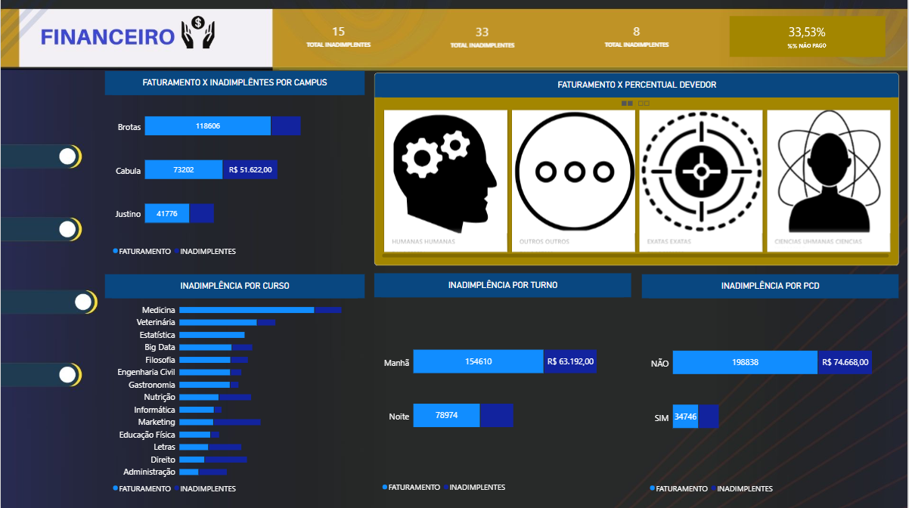
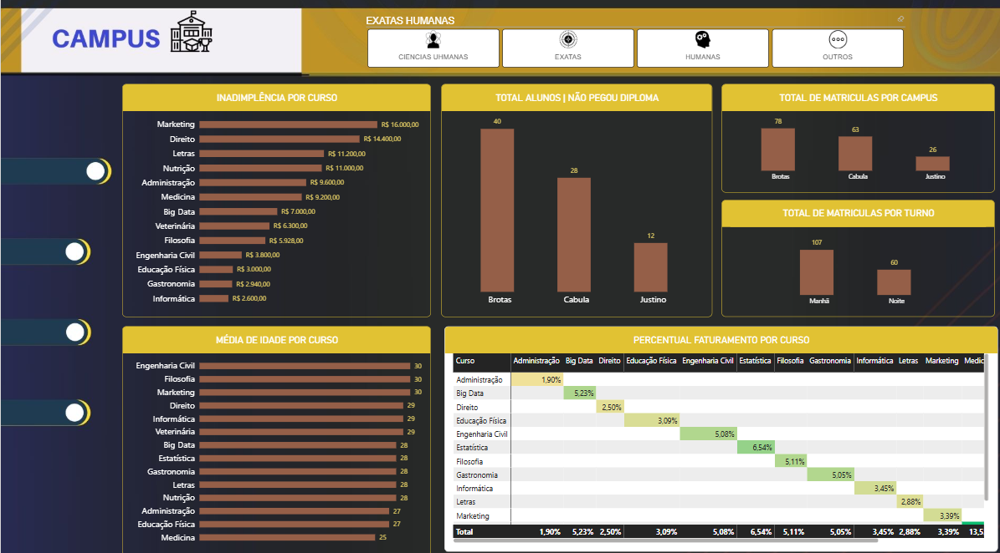
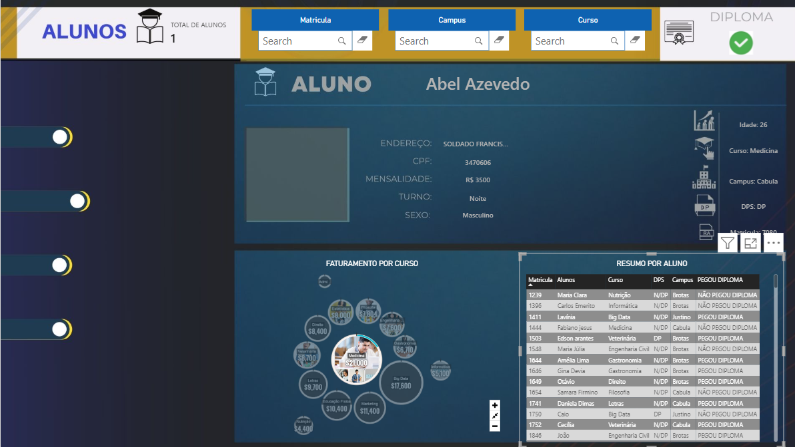

# 🎓 Dashboard Universidade YTO | Power BI

Painel de análise acadêmica e financeira de uma universidade fictícia, construído do zero no Power BI: tratamento em Power Query (linguagem M), modelagem em esquema estrela e medidas em DAX.


## 🎯 Objetivo

Responder perguntas de gestão como:
- Qual o faturamento previsto e quanto está em aberto?
- Quais cursos e campi concentram a inadimplência?
- Como se distribuem matrículas, turnos, DPs e diplomas retirados?
- Qual é a ficha completa de cada aluno?

## 🗂️ Base de dados

Planilha Excel (`Universidade_YTO.xlsx`) com 167 matrículas, 14 cursos, 3 campi (Brotas, Cabula e Justino) e período de 2014 a 2016. Colunas: aluno, matrícula, curso, área, campus, turno, mensalidade, situação de pagamento, gênero, idade, PCD, estágio, DP e retirada de diploma.

> Dados fictícios, disponibilizados para fins de estudo.

## 🛠️ Etapas

**1. Limpeza e transformação (Power Query / M)**
- Padronização de textos e tipos de dados
- Tratamento de valores ausentes (endereços e fotos)
- Criação das tabelas de dimensão a partir da base original

**2. Modelagem de dados (esquema estrela)**
- Fato: `FATO_BASE`
- Dimensões: `dim_alunos`, `dim_cursos`, `dim_campus`, `dim_turno`, `dim_pcd`, `dim_exatas_humanas`, `dim_diploma`
- Tabelas dedicadas às medidas: `MEDIDAS` e `MEDIDAS ALUNOS`

**3. Medidas DAX**
- Faturamento previsto, real e inadimplente
- % pago e % não pago
- Total de matrículas, média de idade e % do faturamento por curso
- Medidas de contexto para a ficha individual do aluno

**4. Visualização**

| Página | Conteúdo |
|---|---|
| **Capa** | Navegação entre as páginas |
| **Financeiro** | Faturamento x inadimplência por curso, campus, turno e PCD; cards giratórios com % pago e valor em aberto por campus |
| **Campus** | Matrículas por campus e turno, média de idade por curso, diplomas retirados e participação no faturamento, com filtro por área (Exatas/Humanas) |
| **Alunos** | Busca por matrícula, curso ou campus com ficha individual: foto, idade, turno, mensalidade, DP e situação do diploma |

Visuais personalizados: Rotating Tile, Chiclet Slicer, Text Filter, Card Browser, Cluster Map e Simple Image.

## 📊 Principais insights

- **Inadimplência de 33,5%**: R$ 102.968 em aberto de R$ 336.552 previstos
- **Cabula** concentra o problema: 52% das matrículas sem pagamento, contra 19% em Brotas
- **Direito, Letras, Marketing e Administração** passam de 60% de inadimplência; Estatística não tem nenhum atraso
- **26% dos alunos** possuem DP, índice maior no turno da noite (30%) que no da manhã (23%)
- Apenas **52%** retiraram o diploma

## 📸 Telas

| Financeiro | Campus | Alunos |
|---|---|---|
|  |  |  |

## 📁 Estrutura

```
├── universidade.pbix
├── dados/
│   └── Universidade_YTO.xlsx
├── imagens/
│   ├── capa.png
│   ├── financeiro.png
│   ├── campus.png
│   └── alunos.png
└── README.md
```

## ▶️ Como abrir

1. Baixe o repositório
2. Abra `universidade.pbix` no Power BI Desktop
3. Se pedir, aponte a fonte para `dados/Universidade_YTO.xlsx` (Transformar dados → Configurações da fonte de dados)

## 👤 Autor

**Iury Benter Magalhães** | Analista de Dados
[LinkedIn](https://www.linkedin.com/in/iury-benter-/?isSelfProfile=true) · [GitHub](https://github.com/Iury-Benter-Magalhaes)
